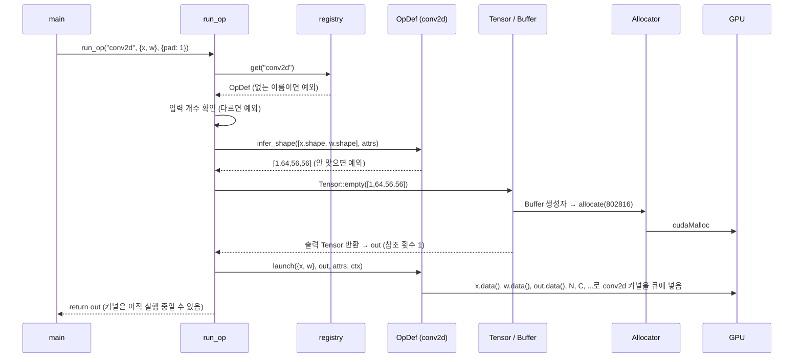
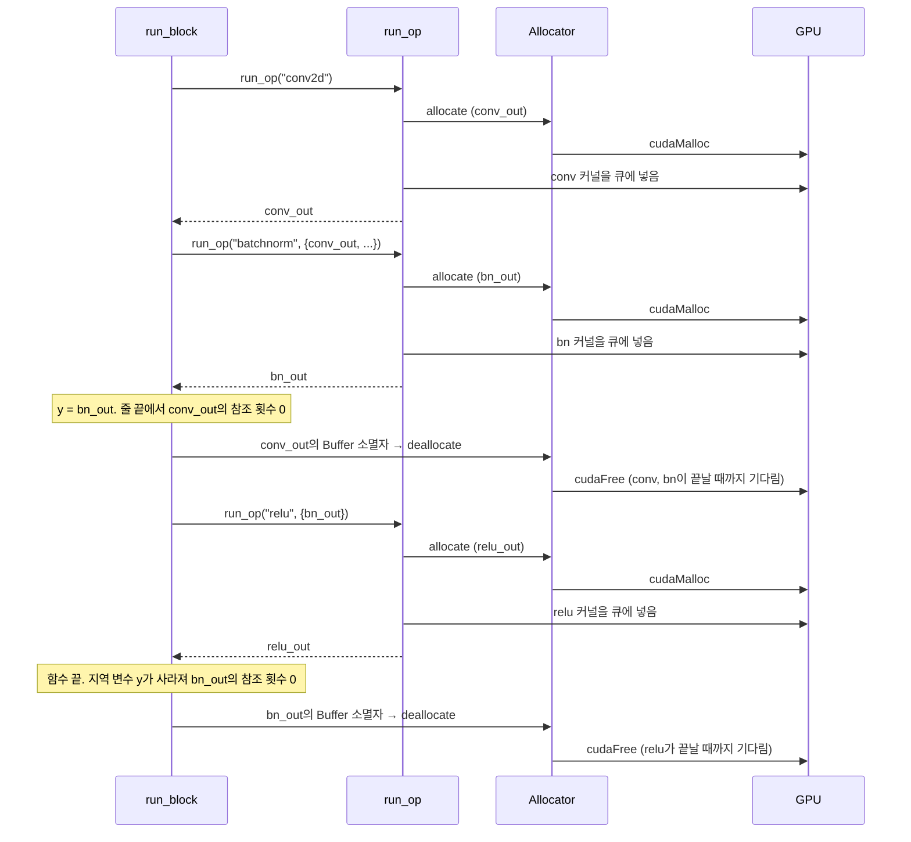

# Week 1: Tensor와 Op, eager 실행

## 이번 주 목표

0주차 main이 손으로 하던 일(할당, 복사, 크기 계산, 커널 호출, 해제)을 runtime의 첫 두 추상화로 옮긴다.

- **Tensor**: GPU 메모리와 shape를 한 객체로 묶고, 메모리를 자동으로 해제한다
- **Op과 registry**: 커널을 이름으로 찾아 실행한다. 출력 shape 계산과 출력 할당도 op이 맡는다

그 위에서 conv → batchnorm → relu 블록을 **eager**로 실행하고,
runtime이 커널 외에 쓰는 시간(오버헤드)이 얼마이고 어디서 오는지 측정한다.

측정 환경: RTX PRO 4000 Blackwell, Intel Core Ultra 9 285K, CUDA 12.8

---

## 1. 배경: 0주차에서 반복되던 것

0주차 main의 `run_gemm`은 커널 하나를 돌리려고 이런 일을 손으로 했다.

```cpp
size_t bytes_A = size_t(M) * K * sizeof(float);   // ① 크기 계산
float* d_A;
cudaMalloc(&d_A, bytes_A);                         // ② 할당
cudaMemcpy(d_A, h_A.data(), bytes_A, ...);
launch_gemm_naive(d_A, d_B, d_C, M, N, K);         // ④ 커널마다 다른 인자
...
cudaFree(d_A);                                     // ② 해제
```

- ① **포인터와 크기를 따로 들고 다녀야 한다.**
  - `d_A`가 M×K라는 사실은 포인터에 붙어 있지 않다. bytes를 계산할 때도, 커널을 부를 때도 매번 직접 넘긴다.
  - 다른 크기를 넘겨도 컴파일된다. 범위 밖을 읽거나 일부만 계산한다.
- ② **`cudaMalloc`마다 `cudaFree`를 짝지어 호출해야 한다.**
  - 중간에 return하면 메모리가 샌다. 두 번 해제하면 죽는다.
- ③ **출력 크기를 op마다 다른 공식으로 계산해야 한다.**
  - 출력을 할당하려면 shape를 먼저 알아야 한다.
  - 작게 잡으면 커널이 할당 밖에 쓴다. 에러 없이 다른 데이터를 덮어쓴다.
- ④ **커널마다 다른 인자 개수와 순서를 맞춰야 한다.** (conv는 12개)
  - 인자가 전부 `int`라 순서를 바꿔도 컴파일된다. 결과만 틀린다.

네 가지 모두 실수해도 컴파일 에러나 실행 에러가 나지 않고, 틀린 결과나 메모리 누수로만 드러난다.

---

## 2. 배경 개념

### RAII와 shared_ptr: 메모리를 언제 해제하나

- **소멸자(destructor)**: 객체가 사라질 때 자동으로 불리는 함수. 
  - 모든 지역 변수는 `{ }`를 벗어날 때 소멸자가 호출된다. (cpp 규칙)
- **소유(ownership)**: 어떤 자원을 "다 쓰면 돌려줄 책임"을 누가 갖는가. 자원의 주인이 사라질 때 자원도 돌려준다.

**RAII: 해제를 소멸자에 둔다**

- 자원은 객체를 만들 때 얻고, 객체가 사라질 때 돌려준다.
- 객체의 수명과 자원의 수명을 묶는 것이다. 
- 소멸자는 자동으로 불리므로, 해제를 소멸자에 두면 잊을 수 없다.

```cpp
struct DeviceMemory {
    void* ptr;
    DeviceMemory(size_t bytes) { cudaMalloc(&ptr, bytes); }
    ~DeviceMemory() { cudaFree(ptr); }
};

{
    DeviceMemory m(1024);      // cudaMalloc
}                              // 나가면서 자동 cudaFree
```

- 단, 이런 객체는 복사하면 안 된다. 포인터만 복사되어 두 객체가 같은 메모리를 각자 해제한다.
- 그래서 **주인은 하나**여야 한다.

**shared_ptr: 주인이 여럿일 때**

- 같은 객체를 여러 곳이 함께 소유하게 해주는 포인터. 
- 마지막 소유자가 사라질 때 객체를 소멸시킨다.
- 같은 메모리를 여러 곳에서 써야 할 때 shared_ptr을 복사한다. (함수 인자, skip connection 등) 

```cpp
{
    auto a = std::make_shared<DeviceMemory>(1024);   // DeviceMemory 생성 → cudaMalloc. 참조 횟수 1
    {
        auto b = a;                                  // shared_ptr 복사. 참조 횟수 2
    }                                                // b가 사라짐. 참조 횟수 1
}                                                    // a가 사라짐. 참조 횟수 0 → ~DeviceMemory → cudaFree
```

- **참조 횟수(reference count)**: 같은 객체를 가리키는 shared_ptr의 수. 복사하면 +1, 하나가 사라지면 −1, 0이 되면 객체가 소멸한다.
- Python 객체도 원래 이렇게 참조 횟수로 해제된다.

### eager 실행과 graph 실행

op을 언제 실행하느냐에 따라 두 방식으로 나뉜다.

**eager: 만나는 대로 실행**

```
run_op("conv2d")    → 지금 바로: OpDef 찾기, shape 계산, 출력 할당, launch
run_op("batchnorm") → 지금 바로: ...
run_op("relu")      → 지금 바로: ...
```

- op을 부르는 순간 처리한다. PyTorch의 기본 방식이고, 이번 주 run_op이 이 방식이다.
- runtime은 매 순간 **지금 실행할 op 하나**만 본다. 다음에 무엇이 올지 모른다.
- "바로"는 CPU가 지금 처리해서 GPU 큐에 넣는다는 뜻이다. launch는 여전히 비동기라, GPU가 바로 끝내는 건 아니다.

**graph: 다 보고 나서 실행**

```
1. 기록   conv → batchnorm → relu를 실행하지 않고 graph로 만든다
2. 준비   graph 전체를 보고 최적화한다
3. 실행   준비된 대로 launch한다
```

전체를 미리 알면 eager가 못 하는 일을 할 수 있다.

| 미리 알면 | 할 수 있는 것 |
|---|---|
| conv 다음에 bn, relu가 온다 | 커널 여러 개를 하나로 합치기 (fusion) |
| 각 텐서를 마지막으로 쓰는 시점 | 메모리를 미리 잡고 재사용, 실행 중 할당과 해제 없음 |
| 실행할 커널 목록 전체 | 목록을 통째로 한 번에 제출해 launch 비용 줄이기 (CUDA Graphs) |

- 예: `torch.compile`(실행하면서 graph를 잡고, 연산을 합친 커널을 생성)
- TensorRT, ONNX Runtime, ExecuTorch(배포 전에 graph를 만들어 최적화)

**eager의 대가**

eager는 미래를 모르기 때문에 안전한 쪽을 택한다.
- 출력을 매번 새로 할당한다.
- 다 쓴 출력은 마지막 참조가 사라지는 순간, 실행 도중에 해제한다.

대신 코드가 단순하고, 한 줄씩 실행되니 디버깅이 쉽다.

---

## 3. 메모리: Allocator, Buffer, Tensor

- Tensor는 **항상 GPU에 있다**고 가정한다.
- CPU 쪽 데이터는 그냥 `std::vector<float>`이고, `from_host`/`to_host`가 경계다.

```
 Tensor a                         Tensor b
┌──────────────────────┐         ┌──────────────────────┐
│ buffer_ ─────────────┼──┐   ┌──┼───────────── buffer_ │
│ shape_  [1,64,56,56] │  │   │  │ shape_  [1,64,56,56] │
│ stride_ [200704,...] │  │   │  │ stride_ [200704,...] │
└──────────────────────┘  │   │  └──────────────────────┘
                          ▼   ▼
              ┌──────────────────────────┐
              │ shared_ptr control block │  참조 횟수 = 2
              └────────────┬─────────────┘
                           ▼
              ┌──────────────────────────┐
              │ Buffer                   │
              │ ptr_       ──────────────┼──────────┐
              │ bytes_     802816        │          │
              │ allocator_ ───────┐      │          │
              └───────────────────┼──────┘          │
                                  ▼                 ▼
              ┌──────────────────────┐   ┌──────────────────────┐
              │ CudaAllocator        │   │ GPU memory           │
              │ sizes_ {0x7f..a000:  │   │ 0x7f..a000           │
              │         802816}      │   │ [802816 bytes]       │
              │ stats_ allocs, ...   │   │                      │
              └──────────────────────┘   └──────────────────────┘
               기본 allocator(default_allocator())는 프로그램에 하나 (singleton)

```

- Tensor 둘은 **각자 shape와 stride를 갖고**, Buffer는 **함께 하나를 가리킨다**.
  - 그래서 같은 Buffer를 다른 shape/stride로 보는 Tensor도 만들 수 있다.  
    - PyTorch `view`: 다른 shape로 본다 (`[2,3]` → `[6]`). 
    - PyTorch `transpose`: shape와 stride의 두 차원을 맞바꾼다 (`[2,3]`/`[3,1]` → `[3,2]`/`[1,3]`).

### Allocator: 할당 방법을 바꿔 끼우는 자리

```cpp
class Allocator {
  public:
    virtual ~Allocator() = default;
    virtual void* allocate(size_t bytes) = 0;   // = 0: 구현은 상속받는 쪽이 한다
    virtual void deallocate(void* ptr) = 0;
};
```

- runtime의 모든 GPU 메모리는 Allocator를 거친다. Tensor는 무엇이 메모리를 주는지 모른다.
- `CudaAllocator`: 요청마다 `cudaMalloc`/`cudaFree`를 부르고, 횟수와 사용량(현재, peak)을 센다.
- 할당 방식을 바꾸고 싶으면 Allocator만 바꾸면 된다.

### Buffer: 스스로 해제되는 메모리 (RAII)

```cpp
// 만들 때 할당 (ptr_ 멤버 변수를 a.allocate(bytes) 값으로 초기화)
Buffer::Buffer(size_t bytes, Allocator& a) : ptr_(a.allocate(bytes)), ... {}

// 사라질 때 해제
Buffer::~Buffer() { allocator_->deallocate(ptr_); }
```

- `cudaMalloc`/`cudaFree`를 직접 부르지 않고 Allocator에 맡긴다.
- GPU 주소와 크기, 그리고 **어느 allocator에서 받았는지**(`allocator_`)를 기억한다. 돌려줄 곳을 알아야 하기 때문이다.

```cpp
Buffer(const Buffer&) = delete;              // Buffer b2 = b1;  → 컴파일 에러
Buffer& operator=(const Buffer&) = delete;   // b2 = b1;         → 컴파일 에러
```

### Tensor: 메모리와 shape를 한 객체로

```cpp
class Tensor {
  public:
    Tensor() = default;                                     // 메모리 없는 빈 Tensor

    static Tensor empty(const Shape& shape, ...);           // 할당만 (값은 채우지 않음)
    static Tensor from_host(const std::vector<float>& data, const Shape& shape, ...);  // 할당 + CPU→GPU 복사
    std::vector<float> to_host() const;                     // GPU→CPU 복사. GPU 작업이 끝날 때까지 기다림

    bool defined() const;          // 메모리가 있는가
    int dim(int i) const;          // i번째 차원 크기
    int64_t numel() const;         // 원소 수
    size_t bytes() const;          // 바이트 수
    float* data();                 // 쓸 수 있는 포인터
    const float* data() const;     // const Tensor에서는 읽기 전용 포인터
  private:
    std::shared_ptr<Buffer> buffer_;
    Shape shape_;
    Shape stride_;
};
```

- **메모리와 크기가 항상 같이 다닌다**: 원소 수, 바이트 수, 각 차원 크기를 Tensor가 shape로 계산한다.
- **`Tensor() = default;`**: 인자 없이 만들면 컴파일러 기본 동작대로 멤버를 초기화한다. 
  - `buffer_`가 nullptr인 빈 Tensor이고, `defined()`로 확인한다.
- **static 팩토리 함수**:
  - static: 객체 없이 클래스 이름으로 부르는 함수. 
  - 팩토리: 객체를 만들어서 돌려주는 함수.
    - `Tensor::empty(shape)`, `Tensor::from_host(data, shape)`처럼 호출한다.
  - 생성자는 이름이 `Tensor`로 고정이라, 인자가 같으면 할당만 수행해야 하는지 0으로 채워야 하는지 구분할 수 없다.

### 생성부터 해제까지

세 부품이 함께 움직이는 모습:

```
Tensor a = Tensor::empty({1,64,56,56});
  Tensor::empty
    → make_shared<Buffer>(802816, allocator)
      → Buffer 생성자: allocator.allocate(802816)
        → CudaAllocator: cudaMalloc, sizes_에 기록, allocs++ (참조 횟수 1)

Tensor b = a;          shared_ptr만 복사 (cudaMalloc 없음) (참조 횟수 2)

a가 사라짐                                            (참조 횟수 1)
b가 사라짐                                            (참조 횟수 0)
  → Buffer 소멸자: allocator_->deallocate(ptr_)
    → CudaAllocator: sizes_에서 크기 찾기, cudaFree, frees++
```

### main의 변화

```cpp
// 0주차                                              // Tensor 적용 후
float* d_A;                                           Tensor A = Tensor::from_host(h_A, {M, K});
cudaMalloc(&d_A, bytes_A);                            launch_gemm_naive(A.data(), ..., M, N, K);
cudaMemcpy(d_A, h_A.data(), bytes_A, ...);
launch_gemm_naive(d_A, ..., M, N, K);
cudaFree(d_A);
```

---

## 4. Op: OpDef, registry, run_op

`run_gemm`과 `run_conv2d`는 코드는 다르지만 순서는 같았다.

```
1. 입력이 맞는지 확인하고 출력 shape 계산    ← op마다 다름
2. 출력 메모리 할당                        ← 모든 op이 같음
3. 커널 호출                              ← op마다 다름
```

### OpDef: op 하나의 설명서

[op.h](../../../include/tir/op.h)

```cpp
struct OpDef {
    std::string name;
    int num_inputs = 0;

    std::function<Shape(const std::vector<Shape>& inputs, const Attrs& attrs)> infer_shape;
    std::function<void(const std::vector<Tensor>& inputs, Tensor& output, 
              const Attrs& attrs, ExecContext& ctx)> launch;
};
```

- `infer_shape`와 `launch`는 **함수를 담는 멤버 변수**다.
  - op마다 다른 함수(lambda)를 넣어두고, 쓸 때는 `def.launch(...)`처럼 호출한다. 
  - 상속(virtual) 없이 op마다 다른 동작을 갖는 방법이다.

| | 받는 것 | 하는 일 |
|---|---|---|
| `infer_shape` | 입력들의 **Shape**, attrs | 출력 shape 계산. 입력이 맞지 않으면 예외 |
| `launch` | 입력 **Tensor**들, 할당된 출력, attrs, ctx | Tensor를 raw pointer와 크기로 풀어서 커널 호출 |

### registry: (Name → OpDef) table

```cpp
class OpRegistry {
    void add(OpDef op);                               // 이미 있는 이름이면 예외
    const OpDef& get(const std::string& name) const;  // 없는 이름이면 예외
    std::map<std::string, OpDef> ops_;
};

OpRegistry& registry() {
    static OpRegistry r = [] {       // 처음 불릴 때 한 번만 실행
        OpRegistry fresh;
        register_all_ops(fresh);     // conv2d, relu, ... 등록
        return fresh;
    }();
    return r;
}
```

- `registry()`는 프로그램에 하나뿐인 `OpRegistry`를 **돌려주는 함수**.
  - 함수 안의 `static` 변수는 **처음 불릴 때 한 번** 만들어지고 프로그램 끝까지 남는다. (singleton)

registry 내부:

```
registry()   (프로그램에 하나, 처음 쓸 때 만들어짐)
┌────────────────────────────┐
│ "batchnorm" → OpDef        │
│ "conv2d"    → OpDef ───────┼──┐
│ "gemm"      → OpDef        │  │
│ "relu"      → OpDef        │  │
└────────────────────────────┘  │
                                ▼
OpDef "conv2d"
┌──────────────────────────────────────────────────────────┐
│ name         "conv2d"                                    │
│ num_inputs   2                                           │
│ infer_shape  x[N,C,H,W], w[K,C,R,S]  →  [N,K,P,Q]        │
│ launch       unpack Tensors into pointers and sizes,     │
│              launch_conv2d_naive(x, w, y, N, C, H, ...)  │
└──────────────────────────────────────────────────────────┘
```

- conv 글자는 cuDNN 표기: 
  - N batch, C 입력 채널, H×W 입력 크기, K 출력 채널, R×S 필터, P×Q 출력 크기.

### run_op: 모든 op이 거치는 순서

[op.cpp](../../../src/core/op.cpp)

```cpp
Tensor run_op(const std::string& name, const std::vector<Tensor>& inputs, const Attrs& attrs, ExecContext& ctx) {
    const OpDef& op = registry().get(name);           // 이름으로 찾기
    // 입력 개수 확인 (num_inputs와 다르면 예외)
    std::vector<Shape> input_shapes = ...;                 // 입력 Tensor들의 shape
    
    Shape out_shape = op.infer_shape(input_shapes, attrs); // output shape 계산
    Tensor out = Tensor::empty(out_shape, *ctx.allocator); // output Tensor 생성
    
    op.launch(inputs, out, attrs, ctx); // kernel launch
    return out;
}
```

- 출력을 어느 Allocator로 할당할지, 커널을 어느 stream에 넣을지는 `ExecContext { stream, allocator }`로 받는다.

### main의 변화

```cpp
// Tensor만 적용 (run_op 전)
int P = (H + 2 * pad - R) / stride + 1;
Tensor y = Tensor::empty({N, K, P, Q});
launch_conv2d_naive(x.data(), w.data(), y.data(), N, C, H, W, K, R, S, pad, stride);

// run_op 적용 후
Tensor y = tir::run_op("conv2d", {x, w}, {{"pad", pad}});
```

---

## 5. 한 번에 보기

### run_op 한 번

main이 `run_op("conv2d", {x, w}, {{"pad", 1}})`를 호출하면:



- main은 이름과 입력만 넘긴다. 
  - 무엇을 실행할지는 registry,
  - 출력 shape와 커널 인자는 OpDef,
  - 메모리는 Tensor → Buffer → Allocator가 맡는다.
- run_op이 돌아올 때 출력은 할당만 되어 있고, 값은 GPU가 커널을 끝내야 채워진다.

### 언제 여러 Tensor가 같은 Buffer를 가리키나

같은 값을 여러 곳에서 쓸 때. 그 값은 **마지막으로 쓰는 곳이 끝날 때까지** 살아 있어야 한다.

```cpp
Tensor identity = x;                       // x와 identity가 같은 Buffer (참조 2)

Tensor y = run_op("conv2d", {x, w1});
y = run_op("batchnorm", {y, ...});
y = run_op("relu", {y});
y = run_op("conv2d", {y, w2});
y = run_op("batchnorm", {y, ...});
y = run_op("add", {y, identity});          // 여기서도 x의 데이터가 필요

return run_op("relu", {y});
```

- 블록 입력 x는 첫 conv와 마지막 add에서 두 번 쓰인다. 사이에 op이 5개 있어도 `identity`가 x의 Buffer를 가리키고 있는 한 살아 있다.

### 언제 Tensor가 사라지나

C++의 변수 수명이 끝나면 그 Tensor가 사라지고, Buffer의 참조 횟수가 1 줄어든다.

| 경우 | 예 |
|---|---|
| 변수를 다른 값으로 덮어쓸 때 | `y = run_op("batchnorm", {y, ...})`: y가 conv_out 대신 bn_out을 가리키게 됨. conv_out의 참조 횟수 −1 |
| 변수가 `{ }` 범위를 벗어날 때 | 함수가 끝나면 지역 변수(`identity` 등)가 사라짐 |
| 임시 객체가 사라질 때 | `run_op("batchnorm", {y, ...})`의 `{y, ...}`는 Tensor 복사본을 담은 임시 vector다. 그 줄이 끝나면 vector와 함께 안의 Tensor들이 사라진다 |

- PyTorch eager도 같다. `x = self.conv(x)`처럼 덮어쓰면 이전 텐서는 참조가 0이 되는 순간 해제된다.

### 블록 한 번: 할당과 해제

conv → batchnorm → relu를 이어서 부르면, 할당은 run_op 안에서, 해제는 `y =` 덮어쓰기와 함수 끝에서 일어난다.

```cpp
// main.cpp의 run_block
Tensor y = run_op("conv2d", {x, w});          // conv_out 할당, y → conv_out
y = run_op("batchnorm", {y, ...});            // bn_out 할당, y → bn_out, 줄 끝에서 conv_out 해제
return run_op("relu", {y});                   // relu_out 할당, 함수 끝에서 bn_out 해제
```



- 블록 한 번에 `cudaMalloc` 3번, `cudaFree` 3번. relu_out은 호출한 쪽이 들고 있다가, 그 변수가 사라질 때 해제된다.
- 해제는 누가 명령하는 게 아니라, 마지막 Tensor가 사라지는 순간 Buffer 소멸자에서 일어난다.
- `cudaFree`는 GPU에 쌓인 작업이 끝날 때까지 기다린다. 그동안 CPU는 다음 커널을 넣지 못한다.

---

## 6. main 따라가기

[main.cpp](../../../main.cpp)

### 준비: Param과 Block

- **Param**: 같은 값을 CPU(`std::vector<float>`)와 GPU(`Tensor`) 양쪽에 들고 있는 구조체. 
  - CPU reference는 포인터를, GPU 쪽은 Tensor를 받기 때문이다.
- **Block**: conv 가중치와 batchnorm parameter를 묶은 것.

### trace: 왜 필요한가

```cpp
struct Step {
    std::string op;
    std::vector<Tensor> inputs;
    Attrs attrs;
    Tensor output;
};
```

- 커널 단위 측정은 op 하나를 블록 안에서와 **똑같은 입력, 출력, attrs**로 따로 반복 실행한다.
- 그런데 블록이 끝나면, 각 op의 입력이던 이전 op의 출력(conv_out, bn_out)은 이미 해제된 뒤다.
- 그래서 정확성 단계의 한 번 실행에서, op 하나를 실행할 때마다 Step을 하나씩 기록한다. 
  - Step이 Tensor를 들고 있으니 이 Buffer들이 해제되지 않는다.

### 측정 실험

| 단계 | 실행 | 측정 방법 | 얻는 것 |
|---|---|---|---|
| 정확성 | 블록 1번, trace 기록 | 없음 | CPU와 비교, warmup, 재실행용 기록 |
| end-to-end | 블록 20번, trace 없음 | CPU clock + 끝에서 sync | 블록 시간(중앙값), 실행당 할당 횟수 |
| 커널 단위 | trace의 op마다 `launch`만 100번 | cudaEvent | 커널 실행 시간 |

---

## 7. 측정과 해석

### main 출력

```
check vs CPU reference: OK (0 mismatches)                 ← 정확성

op         output            kernel (us)                  ← 커널 단위
conv2d     [1,64,56,56]            229.1
batchnorm  [1,64,56,56]              2.2
relu       [1,64,56,56]              1.5

sum of kernel times :    232.8 us                         ← 커널 단위의 합
block end to end    :    288.2 us  (median of 20)         ← end-to-end
runtime overhead    :     55.3 us  (19% of the block)     ← end-to-end − 커널 단위의 합
per run             : 3 run_op calls, 3 cudaMalloc, 3 cudaFree
```

### 오버헤드는 어디서 오나: GPU가 논 구간

nsys 기록에서 블록 실행 한 번을 꺼내, GPU가 놀던 구간을 모았다.

| GPU가 논 구간 | 시간 | 원인 |
|---|---:|---|
| 첫 커널 전 | ~27 us | 그중 22us가 conv_out의 `cudaMalloc` |
| bn → relu 사이 | ~7 us | `cudaFree`가 기다리느라 relu launch가 늦어짐 |
| 마지막 커널 후 | ~24 us | 그중 23us가 relu_out의 `cudaFree` |
| conv → bn 사이 | 0.3 us | conv가 도는 동안 CPU가 bn을 미리 넣어 둠 |

- 합치면 약 55us로 main의 runtime overhead와 맞는다.

---

## 8. 정리

- **메모리 해제는 자동이다.** Buffer(RAII)가 해제를 맡고, shared_ptr이 마지막 Tensor가 사라지는 순간을 센다. Tensor 복사는 shared_ptr 복사라 싸다.
- **op 실행을 op마다 다른 것(OpDef)과 모든 op에 같은 순서(run_op)로 나눴다.** main은 이름과 입력만 넘긴다.
- **eager는 미래를 모른다.** 그래서 출력을 매번 할당하고, 다 쓴 출력을 실행 도중에 해제한다.
- **eager의 오버헤드는 할당과 해제에서 온다.** 이 블록에서는 커널 233us에 55us(19%)가 더해졌고, 대부분이 처음의 `cudaMalloc`과 끝의 `cudaFree`, 그리고 `cudaFree`의 대기였다.
